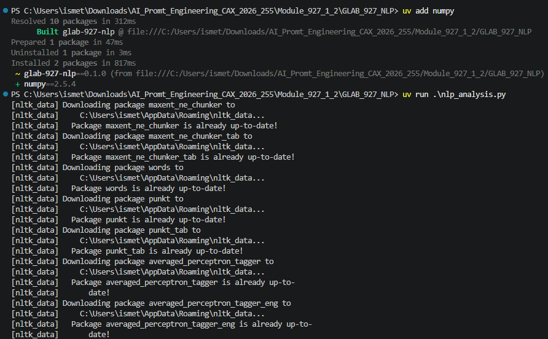
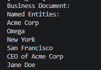
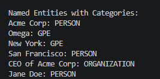
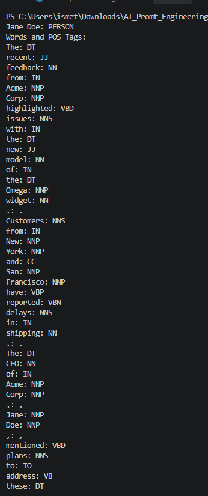

# Lab 06 — Text Analysis Using NLP Techniques


Explore named entity recognition (NER) and part-of-speech (POS) tagging on sample customer feedback using Python and NLTK.

---

## What You Will Learn

| Skill | Purpose |
| --- | --- |
| Tokenization | Break business text into tokens for analysis. |
| Named entity recognition | Identify candidate names of people, organizations, and locations. |
| Entity categories | Examine the labels assigned to detected entities. |
| POS tagging | Label the grammatical role of each token. |

## Prerequisites

- Python 3.10 or later
- [uv](https://docs.astral.sh/uv/)
- Internet access for initial dependency and NLTK data downloads

## Setup and Run

Open a terminal in this lab folder and run:

```powershell
uv sync
uv run python nlp_analysis.py
```

The first run downloads NLTK resources. The script prints named entities, their predicted categories, and each token with its POS tag. The setup screenshot shows the original lab environment; the commands above use this repository's project settings.



## Task 1 — Extract Named Entities

Tokenize the sample business document and use NLTK's named entity chunker to identify candidate entities.



## Task 2 — Print Entity Categories

Print each entity alongside its predicted category. The sample output illustrates why labels need review: the model labels Acme Corp and San Francisco as people and Omega as a location.



## Task 3 — Tag Parts of Speech

Print each token and its POS tag. For example, `NNP` indicates a proper noun and `VBD` indicates a past-tense verb. Punctuation is tagged too.



## Key Takeaway

NER and POS tagging help structure business text, but NLTK's predictions can be wrong. Review the output in context, especially before drawing business conclusions.

## Project Files

| File | Purpose |
| --- | --- |
| `nlp_analysis.py` | Implements the three lab tasks. |
| `pyproject.toml` | Defines Python and NLTK requirements. |
| `screenshots/` | Shows the original setup and sample results. |

[← Back to all labs](../README.md)
