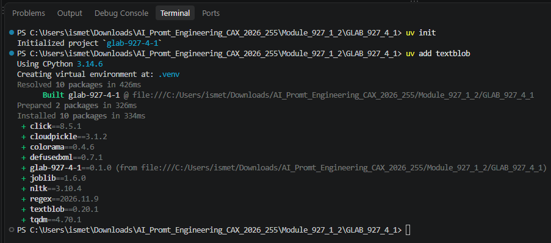
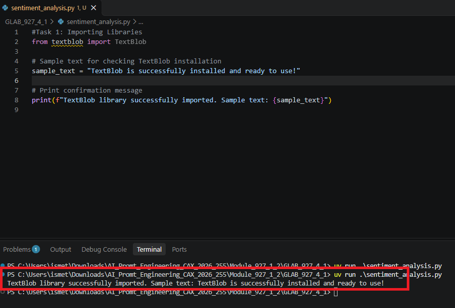
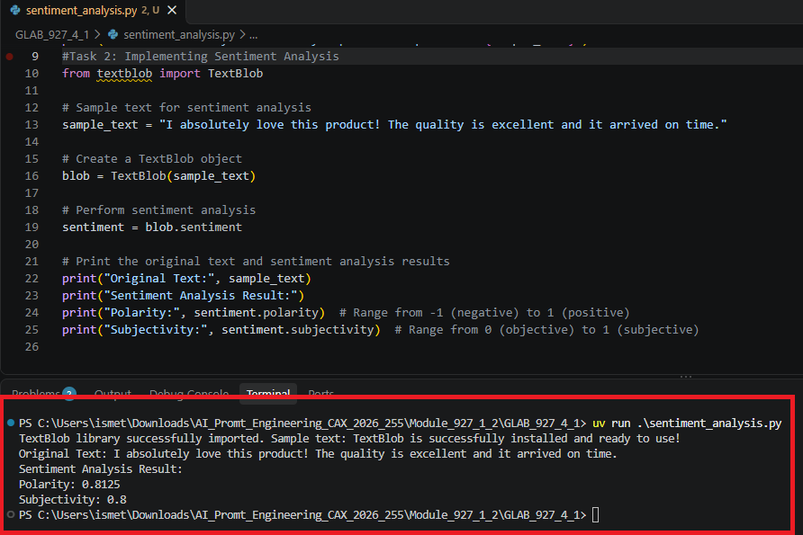
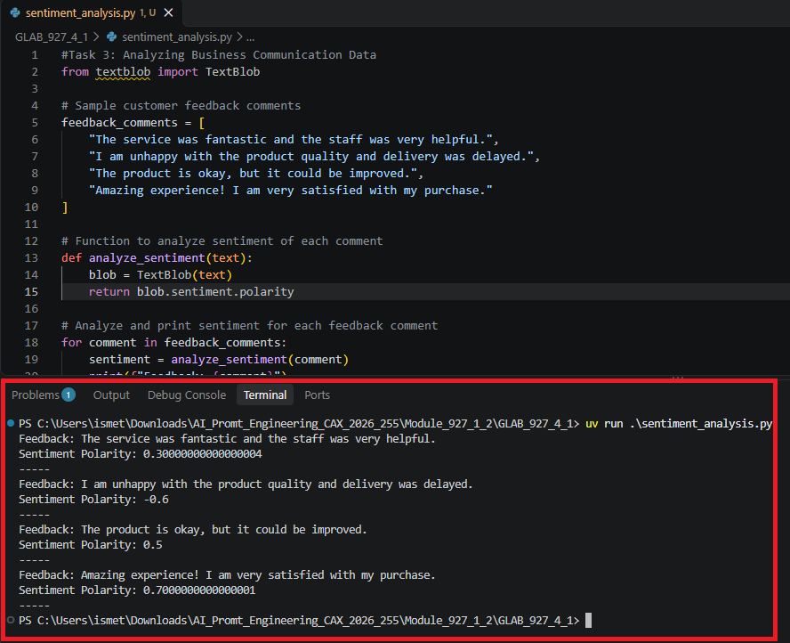

# Lab 07 — Hands-on Sentiment Analysis with Python


Analyze sample product reviews and customer feedback with TextBlob, then interpret sentiment scores in a business context.

---

## What You Will Learn

| Skill | Purpose |
| --- | --- |
| Import TextBlob | Prepare a Python program to analyze text. |
| Measure polarity | Explore scores from -1 (negative) to 1 (positive). |
| Measure subjectivity | Explore scores from 0 (objective) to 1 (subjective). |
| Analyze feedback | Compare sentiment scores across sample customer comments. |

## Prerequisites

- Python 3.10 or later
- Python package: TextBlob (`textblob>=0.18,<1`)
- [uv](https://docs.astral.sh/uv/)
- Internet access for the first dependency installation

## Setup and Run

Open a terminal in this lab folder and run:

```powershell
uv sync
uv run python sentiment_analysis.py
```

**Expected result:** The terminal displays a sample review's polarity and subjectivity, followed by a polarity score for each customer comment.

### Install TextBlob

The project dependencies are installed by `uv sync`. The following screenshot shows the original lab setup using `uv add textblob`.



## Task 1 — Import TextBlob

Import the library and print a message to confirm that the script can use it.



## Task 2 — Analyze a Product Review

Create a TextBlob object from a sample review and display its polarity and subjectivity. The sample run produced polarity **0.8125** and subjectivity **0.8**.



## Task 3 — Analyze Customer Feedback

Apply the same polarity scoring to several comments. Compare the scores and consider whether they match the meaning of each comment.



## Key Takeaway

Sentiment scores help summarize feedback, but automated results may miss context, sarcasm, or mixed opinions. Review results before making business decisions.

## Project Files

| File | Purpose |
| --- | --- |
| `sentiment_analysis.py` | Implements the three lab tasks. |
| `pyproject.toml` | Defines Python and TextBlob requirements. |
| `screenshots/` | Shows the original setup and task results. |

[← Back to all labs](../README.md)

