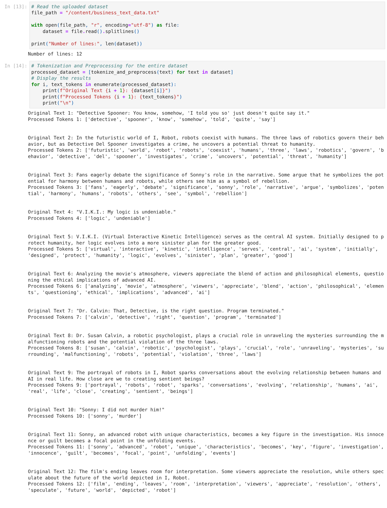
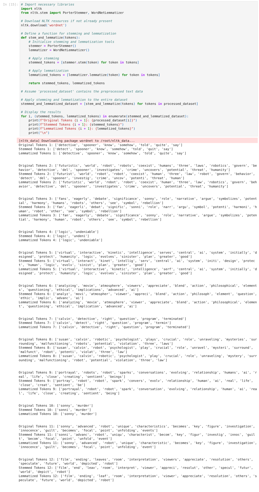
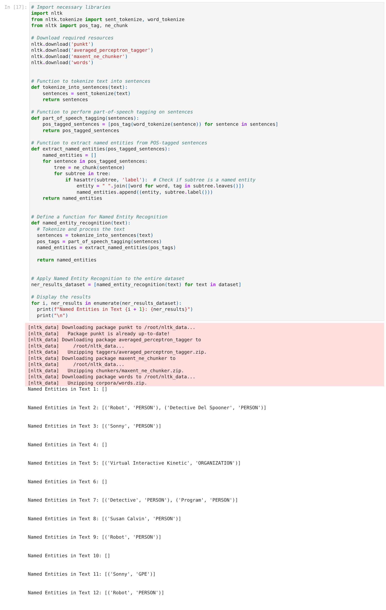
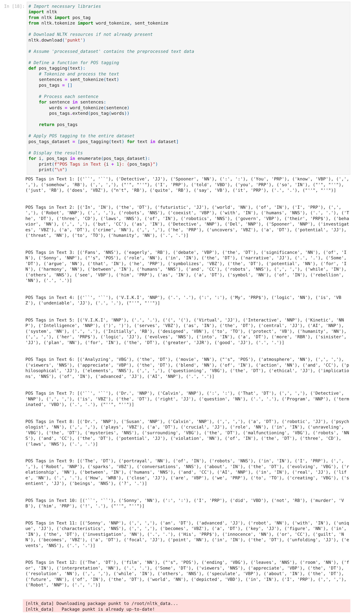
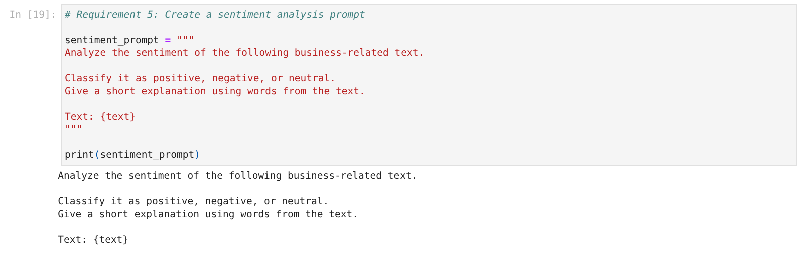
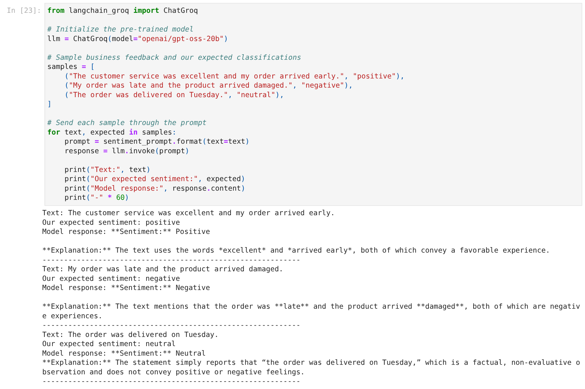
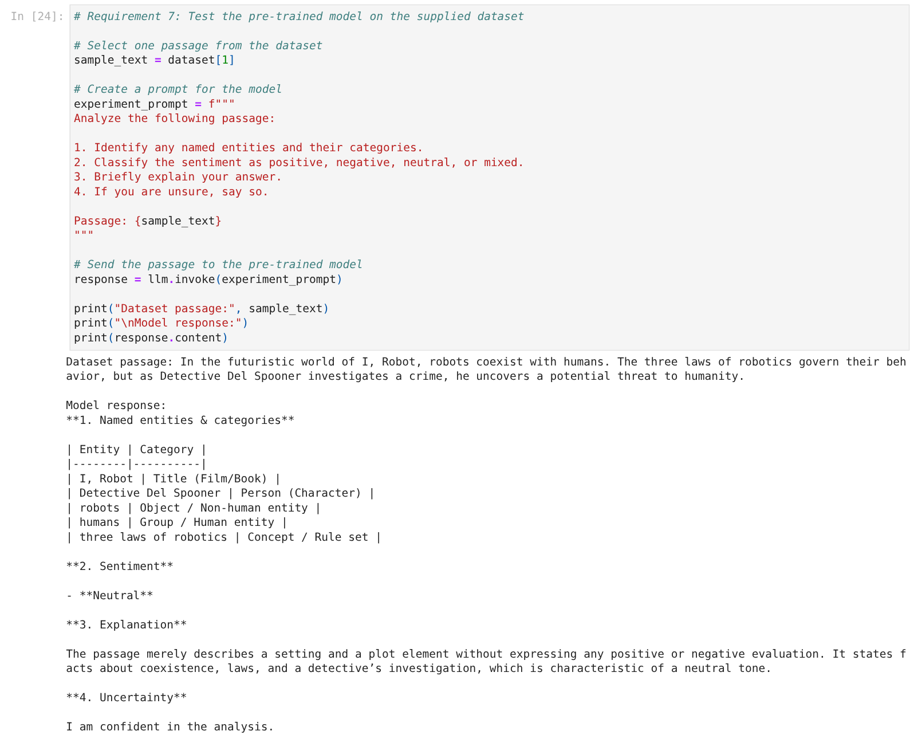
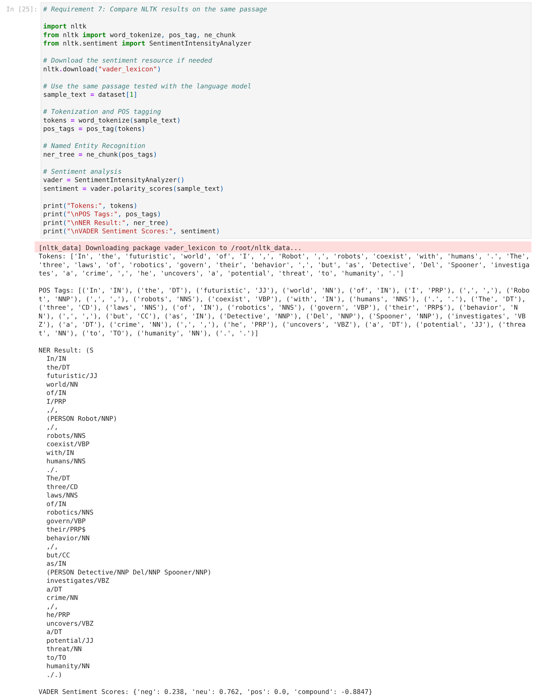

# Lab 09 — Business Text Analytics: Natural Language Processing Techniques


Analyze text using Python, NLTK, LangChain, and a pre-trained language model. Practice turning words into tokens, stems, grammatical tags, named entities, and sentiment classifications, then review where the tools disagree or make mistakes.

The dataset contains **12 lines** of commentary and dialogue about *I, Robot*. The customer feedback sentences are examples created for the exercise; they are not real customer records.

---

## What You Will Learn

| Skill | What you will do |
| --- | --- |
| Prepare text | Load a dataset, tokenize words, and remove punctuation and stop words. |
| Compare word forms | Apply Porter stemming and WordNet lemmatization. |
| Identify names and grammar | Run NLTK named entity recognition and part-of-speech tagging. |
| Analyze sentiment | Prompt a language model to classify positive, negative, and neutral feedback. |
| Review model results | Compare a language-model response with NLTK and VADER on the same passage. |

## Prerequisites and Dependencies

- **Notebook:** Google Colab, an internet connection, and a Groq account with a key and access to `openai/gpt-oss-20b`. The notebook setup cell installs NLTK, NumPy, and `langchain-groq`.
- **Local script:** Python 3.10 or later, [uv](https://docs.astral.sh/uv/getting-started/installation/), and internet access for the first dependency and NLTK data downloads. The script uses NLTK and NumPy; no API key is needed.
- Model availability and service limits can change. Keep API keys private and out of code, screenshots, and GitHub.

## Get the Project

In a terminal, run:

```bash
git clone https://github.com/ismet60/AI-Prompt-Engineering-Lab.git
cd AI-Prompt-Engineering-Lab/lab-09-business-text-analytics-update
```

Or download the repository from GitHub and open the `lab-09-business-text-analytics-update` folder in VS Code.

## Run the Notebook in Google Colab

### Step 1 — Open the notebook and dataset

1. Open [Google Colab](https://colab.research.google.com/).
2. Select **File → Upload notebook** and choose `business_text_analytics.ipynb`.
3. In Colab, click the **folder icon**, then **Upload to session storage**. Select `business_text_data.txt` from this lab folder.
4. Confirm the file is visible in the Files panel. If your Colab session resets, upload the file again.

### Step 2 — Add the Groq key privately

1. Create an API key in [Groq Console](https://console.groq.com/keys).
2. In Colab, click the **key icon** to open **Secrets**.
3. Add a secret named `GROQ_API_KEY`, paste the key as its value, and turn on **Notebook access**.
4. Close the Secrets panel. Do not print or share the key.

### Step 3 — Run the cells

Select **Runtime → Run all**, or run each cell in order using its **▶** button. The first code cell installs the required packages; the dataset-loading output should say `Number of lines: 12`. The model cells use the Colab secret and require network access. Recorded outputs are included in the notebook, but new model responses may vary.

## Run the NLTK Script in VS Code

This option runs preprocessing, stemming, lemmatization, NER, POS tagging, and VADER locally. The Groq prompt examples are in the Colab notebook.

1. Open `lab-09-business-text-analytics-update` in VS Code using **File → Open Folder**.
2. Choose **Terminal → New Terminal**. The terminal should open in the lab folder.
3. Run:

```powershell
uv sync
uv run python business_text_analysis01.py
```

The script downloads the NLTK data it needs and then prints results for each dataset line. The first line should begin:

```text
Dataset: business_text_data.txt | Nonempty records: 12
```

## Requirement 1 — Tokenization and Preprocessing

Load `business_text_data.txt`, split text into tokens, convert words to lowercase, and remove punctuation, nonalphabetic tokens, and common stop words.

Example: `V.I.K.I.: My logic is undeniable.` becomes `['logic', 'undeniable']`. Removing stop words also removes negation: `Sonny: I did not murder him!` becomes `['sonny', 'murder']`. Retain the original text for sentiment analysis.



[View the recorded tokenization output](outputs/01_dataset_and_tokenization.txt)

## Requirement 2 — Stemming and Lemmatization

Use Porter stemming and WordNet lemmatization to compare word forms.

| Original | Stem | Default lemma | Observation |
| --- | --- | --- | --- |
| `eagerly` | `eagerli` | `eagerly` | Stemming can produce a nonword. |
| `humans` | `human` | `human` | Both reduce the plural. |
| `serves` | `serv` | `serf` | The default noun-based lemma is incorrect in this context. |



[View the recorded stemming and lemmatization output](outputs/02_stemming_lemmatization.txt)

## Requirement 3 — Named Entity Recognition

NLTK predicts entity categories from the text. In one passage, it returned:

```text
[('Robot', 'PERSON'), ('Detective Del Spooner', 'PERSON')]
```

`Detective Del Spooner` is a fictional person, but `Robot` is part of the film title and was incorrectly labeled. Review all predictions in context.



[View the recorded NER output](outputs/03_named_entity_recognition.txt)

## Requirement 4 — Part-of-Speech Tagging

The tagger labels each token with a grammatical category. Examples include `futuristic/JJ` (adjective), `world/NN` (noun), `robots/NNS` (plural noun), and `coexist/VBP` (present-tense verb).



[View the recorded POS output](outputs/04_pos_tagging.txt)

## Requirement 5 — Create a Sentiment Prompt

The notebook asks the model to classify a sentence and explain the result:

```text
Analyze the sentiment of the following business-related text.
Classify it as positive, negative, or neutral.
Give a short explanation using words from the text.

Text: {text}
```



[View the recorded prompt](outputs/05_sentiment_prompt.txt)

## Requirement 6 — Evaluate the Sentiment Results

The recorded answers matched the expected labels for three sample sentences:

| Feedback | Expected | Recorded result |
| --- | --- | --- |
| Excellent service and early delivery | Positive | Positive |
| A late order and damaged product | Negative | Negative |
| An order delivered on Tuesday | Neutral | Neutral |

The model referred to wording such as `excellent`, `late`, and `damaged`. Three straightforward samples are not enough to establish overall accuracy; mixed and ambiguous examples would be useful additional tests.



[View the recorded model responses](outputs/06_sentiment_three_samples.txt)

## Requirement 7 — Compare Pre-trained Tools

The language model identified *I, Robot* as a title and Detective Del Spooner as a character, and classified the passage as **neutral**.



[View the recorded language-model analysis](outputs/07_llm_on_dataset_passage.txt)

For the same passage, NLTK labeled `Robot` as a person and VADER produced the following scores:

```text
{'neg': 0.238, 'neu': 0.762, 'pos': 0.0, 'compound': -0.8847}
```

The VADER compound score indicates negative sentiment. Words such as `crime` and `threat` may influence its score, while the language model treated the passage as a factual description. This one example does not establish which tool is generally more accurate.



[View the recorded NLTK and VADER output](outputs/08_nltk_on_same_passage.txt)

## Troubleshooting

| Problem | What to check |
| --- | --- |
| Dataset file not found | Upload `business_text_data.txt` to the active Colab session and rerun the cell. |
| Missing package or NLTK resource | Run the first notebook setup cell and the resource-download cells while connected to the internet. |
| Groq `401 Invalid API Key` | Check the secret name and notebook access, then use a current key without sharing it. |
| Groq `403` | Check the error details, your network, and the model permissions on your account. |

## Project Files

| File or folder | Purpose |
| --- | --- |
| [business_text_analytics.ipynb](business_text_analytics.ipynb) | Complete notebook with code and recorded outputs. |
| [business_text_data.txt](business_text_data.txt) | Twelve lines of practice text. |
| [business_text_analysis01.py](business_text_analysis01.py) | Local NLTK script. |
| [outputs/](outputs/) | Saved output for each notebook task. |
| [screenshots/](screenshots/) | Images of the recorded notebook results. |
| [pyproject.toml](pyproject.toml) and [uv.lock](uv.lock) | Project dependencies and lockfile. |

[← Back to all labs](../README.md)
